# Amori — Business Requirements Document (BRD) v2.0

| | |
|---|---|
| **Product** | Amori — a private, two-person couples app (iOS + Android) |
| **Audience** | QA / Automation Tester |
| **Version** | 2.0 · 2026-10-10 (supersedes `BRD_Amori.md` v1.0, 2026-09-23) |
| **Code baseline** | branch `feature/new_features`, commit `e3ba528` |
| **Diagrams** | Mermaid (renders on GitHub, VS Code/Kiro markdown preview, GitLab, Confluence Mermaid macro) |

**What's new since v1.0:** Let's Chat (guided messages), Vision Board, How to Know Me (Support Profile), Weekly Reflection, Send-a-Gift to partner, Daily Gift can now be a vision item, Achievements / levels / badges, memory videos + voice notes + links, anniversary auto-fill on the calendar, bucket list + to-do list on Together, expanded push notification types and tap routing, plus a list of defects found while writing this document (§9).

---

## Table of contents

1. [How to use this document](#1-how-to-use-this-document)
2. [Product overview & glossary](#2-product-overview--glossary)
3. [System architecture & environments](#3-system-architecture--environments)
4. [Navigation map](#4-navigation-map)
5. [Cross-cutting requirements](#5-cross-cutting-requirements)
6. [Feature requirements](#6-feature-requirements)
7. [Backend-only APIs (no app UI)](#7-backend-only-apis-no-app-ui)
8. [Data model overview](#8-data-model-overview)
9. [Known issues & risks found during analysis](#9-known-issues--risks-found-during-analysis)
10. [Test environment, data & automation guidance](#10-test-environment-data--automation-guidance)
11. [Priority matrix](#11-priority-matrix)

---

## 1. How to use this document

- Every testable rule has an **ID** (e.g. `CHAT-07`). Reference these IDs in test cases so coverage is traceable.
- Each feature section follows the same shape: **Purpose → Entry points → Screens → Flow diagram → Business rules → Validation & messages → API → Notifications → Edge cases / test ideas**.
- Quoted strings in `"double quotes"` are the **exact** user-facing text in the code at the baseline commit. Assert on them.
- **Status tags:**
  - ✅ **Implemented** — UI + API wired end to end.
  - ⚠️ **Partial** — wired, but with known gaps or defects (see §9).
  - 🔌 **API only** — backend endpoints exist, no app UI. Test via API (Insomnia collection `amori-insomnia.json` in repo root).
- **Two accounts are needed for almost everything.** Convention: **User A** (primary) and **User B** (partner). "Linked pair" = A and B have completed partner linking (§5.3).

---

## 2. Product overview & glossary

Amori connects exactly **two** accounts into one **relationship**. Once linked, partners share moods, hugs, memories, a calendar, a vision board, a relationship "help desk", guided messages and games. Some data is **private per user** (Vault, chat drafts, private support-profile fields, splitting journal detail); most is **shared** with the partner subject to privacy toggles.

| Term | Meaning |
|------|---------|
| **Sanctuary** | The Home dashboard. |
| **Linked pair / Relationship** | Two users joined via partner linking. Max 2 members. |
| **Check-in** | A mood log (quadrant + specific mood). |
| **Hug** | A one-tap "thinking of you" ping with optional whisper text. |
| **Space window** | A countdown ("I need 15 min / 30 min / 1 h") set during the Splitting flow, shown on both partners' Home. |
| **Splitting** | Guided self-regulation flow for emotional overwhelm ("I'm Splitting" / SOS). |
| **Help Desk / Desk / Care ticket / Incident** | ITIL-style tracker for relationship issues, with SLA. |
| **Let's Chat** | Guided, template-based message composer for hard or tender conversations. |
| **Vault / Hearth Vault** | A user's private collection of saved cards (gifts). |
| **Daily Gift / Artifact** | One memory or vision item revealed per day as a collectible card (1 of 10 designs). |
| **Vision Board / "Us"** | Shared board of dreams/goals organised in sections ("shelves"). |
| **How to Know Me / Support Profile** | Each user's 7-section handbook for their partner, with per-field privacy. |
| **Weekly Reflection** | Monday–Sunday retrospective of mood and moments; can be archived. |

---

## 3. System architecture & environments

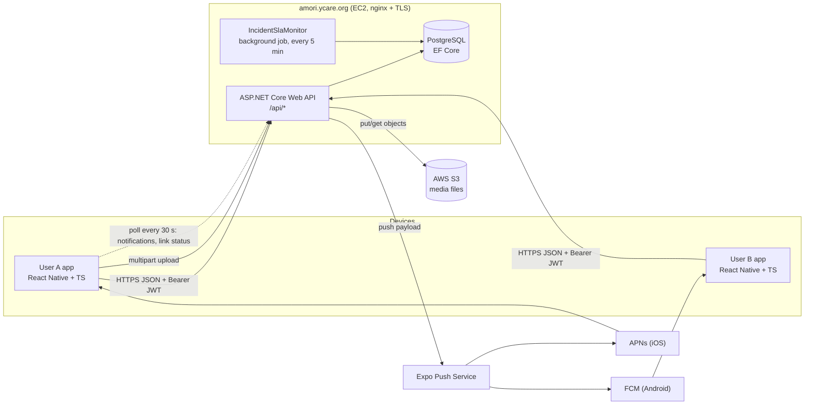

| Item | Value |
|------|-------|
| API origin | `https://amori.ycare.org` (used by both debug and release builds by default). Local options in `src/services/api/client.ts`: Android emulator `http://10.0.2.2:5001`, LAN `http://<mac-ip>:5001`. |
| Health check | `GET /api/health` (anonymous). |
| Auth | JWT access token (**60 min**) + refresh token (**7 days**), from `appsettings.json` `Jwt` section. |
| Real-time | **None.** There is no WebSocket/SignalR in the app. "Live" behaviour = push + polling (§5.4). |
| Background jobs | Only `IncidentSlaMonitor` (first scan 30 s after start, then every 5 min). Nothing delivers calendar reminders, daily digests or server-side check-in reminders (§9). |
| Widgets | Partner-mood home-screen widget / Live Activity via native `AmoriWidgetBridge`; failures are swallowed and never block a flow. See `docs/WIDGETS_AND_LIVE_ACTIVITIES.md`. |

---

## 4. Navigation map

The bottom bar has **5 visible tabs**. Every other area is a **hidden tab** (no bar button) reached from buttons, cards or push taps.

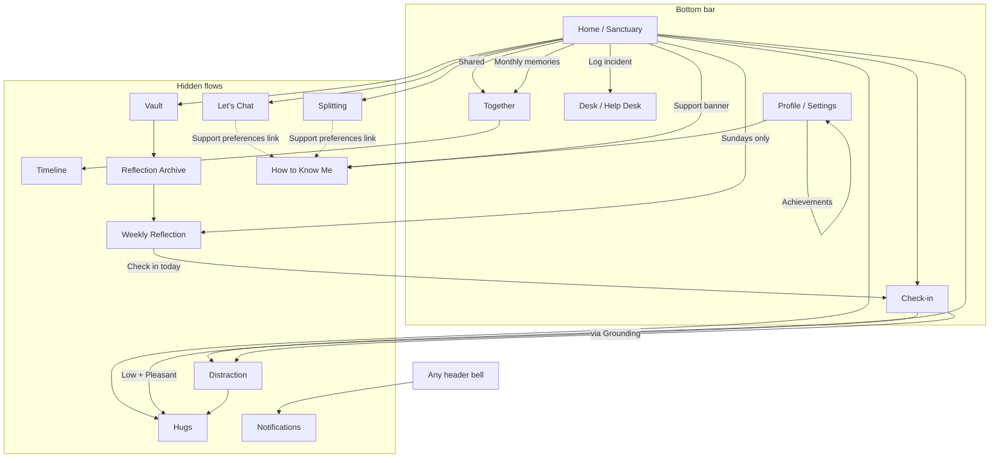

### 4.1 Screens per stack

| Stack | Screens |
|-------|---------|
| Check-in (`MoodStack`) | CheckInHome, MoodBreathe, MoodGrounding, MoodGift, MoodDetail, Exercise54321, ExerciseBodyScan, ExerciseWarmDrink, ExerciseWalk |
| Together | TogetherHome, Calendar, CalendarDay, AddCalendarEvent, ImportantDates, DateIdeas, Wishlist, Memories, AddMemory, MonthlyMemories, MonthlySnapshot\*, RelationshipTimeline, MemoryMap, VisionBoard, VisionBoardItemDetail, AddVisionBoardItem |
| Desk (`IncidentStack`) | HelpDesk, IncidentList, LogIncident, IncidentDetail, AddResponse, AddNote, ResolveIncident, CloseIncident, ReopenIncident, IncidentReview, IncidentLessons, IncidentConversation\*, IncidentHistory\*, IncidentSla\*, Splitting |
| Profile | ProfileHome, Achievements (+ Link Partner and Change Password modals) |
| Hugs | NeedAHug, HugSent, BreatheTogether, HugsHistory |
| Splitting | SplittingIntro, GroundingCheckpoint, InwardCheck, BreatheWithMe, SafeTransition, DeEscalationPacing, GroundingActivities, CompassionBridge, DistractionCentre, PartnerDispatch, SanctuaryJournal, SplittingHistory |
| Distraction | DistractionHome, HiddenNumber, Game2048, CoupleQuiz, WouldYouRather, SomaticSuite |
| Chat | ChatHome, ChatCompose, ChatPreview, ChatSent, ChatReceived, ChatDrafts, ChatHistory |
| Timeline | TimelineHome, AddTimelineEvent |
| Support Profile | SupportProfileHome, SupportSectionEditor, PartnerSupportProfile |
| Single screens | Vault, Notifications, WeeklyReflection, WeeklyReflectionArchive |

\* Registered but **no button navigates to them** at the baseline (orphan screens). SLA and conversation content is shown inline on IncidentDetail instead. Don't write navigation tests for these; flag if the product intends them to be reachable.

### 4.2 Home quick actions

| Home control | Destination |
|--------------|-------------|
| Check in | Check-in tab |
| Send a hug | Hugs → NeedAHug |
| Distraction | Distraction → DistractionHome |
| SOS / I'm splitting | Splitting → SplittingIntro |
| Let's Chat | Chat → ChatHome |
| Log incident | Desk → LogIncident |
| Shared | Together tab |
| View vault / Open Vault | Vault |
| Monthly memories widget | Together → MonthlyMemories (current month) |
| Weekly reflection card (Sundays only) | WeeklyReflection |
| Support Profile banner (until 7/7 sections done) | SupportProfile → SupportProfileHome |
| Header bell | Notifications |
| Header level badge | Profile |

---

## 5. Cross-cutting requirements

These apply to every feature. Validate them once thoroughly, then assume them elsewhere.

### 5.1 API contract & error handling

| ID | Requirement |
|----|-------------|
| API-01 | All endpoints except `/api/auth/register`, `/api/auth/login`, `/api/auth/refresh` and `/api/health` require `Authorization: Bearer <accessToken>`. |
| API-02 | Successful responses return the DTO directly (camelCase JSON). `204 No Content` is used for "nothing" results (e.g. no partner-active splitting session, no random date idea). |
| API-03 | Errors return `{ "success": false, "message": "...", "errors": [] }` with status mapped as below. The app shows `message` to the user. |
| API-04 | Nearly every feature endpoint requires the caller to belong to a relationship. Unlinked users get **404** `"You are not a member of any relationship."` |
| API-05 | Partner-dependent actions (send hug, send chat, send gift, reassign incident) return **409** `"Your relationship does not have a second partner yet."` when the relationship has only one member. |

| Server exception | HTTP | Typical message |
|------------------|------|-----------------|
| NotFound | **404** | `"Memory with id '…' was not found."`, `"You don't have a linked partner yet."` |
| Unauthorized | **401** | `"Invalid email or password."`, **and also permission denials** such as `"Only the creator can delete this memory."` (see §9 BUG-07) |
| Validation | **422** | Single message (e.g. `"Title is required."`) or `"One or more validation errors occurred."` with an `errors` array |
| Conflict | **409** | `"A sent message can no longer be edited."`, `"Only in-progress sessions can be completed."` |
| Unhandled | **500** | `"An unexpected error occurred."` (prod), raw message (dev) |

**Client-side mapping** (`src/services/api/client.ts`):

| Condition | User-facing message |
|-----------|--------------------|
| Non-JSON 413 (nginx) | `"That file is too large to upload. Try a smaller image."` |
| Non-JSON 502/503/504 | `"The server is unavailable right now. Please try again in a moment."` |
| Other non-JSON | `"Unexpected server response (HTTP <status>)."` |
| JSON error with no message | `"HTTP <status>"` |

**Generic UI feedback components** (assert on these overlays/banners):

- Success overlay (`showSuccessOverlay`) — full-screen animated tick + text, e.g. `"Incident logged"`.
- Error overlay (`showErrorOverlay`) — auto-dismisses after **2.5 s**, e.g. `"Couldn't save to your vault"`.
- Banner (`showSuccess` / `showError`) — top banner, e.g. `"Deleted!"` / `"Sorry that failed :("`.
- Native `Alert.alert` dialogs for confirmations and some errors.

### 5.2 Authentication & session ✅

**Screen:** Login (toggle between **Sign in** and **Create account**). Fields carry accessibility labels `"Your name"` (register only), `"Email address"`, `"Password"`.

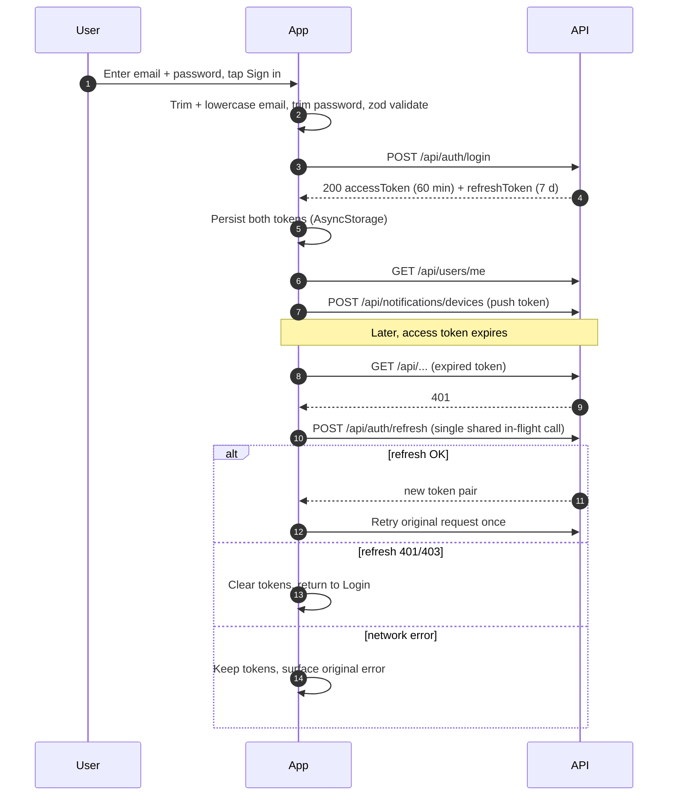

| ID | Requirement | Test focus |
|----|-------------|-----------|
| AUTH-01 | Register requires name, email, password. | Empty name → `"Please enter your name."` |
| AUTH-02 | Client validates email format on login and register. | `abc@` → `"Please enter a valid email address."`; empty password → `"Please enter your password."` |
| AUTH-03 | Email is trimmed and lowercased; password is trimmed (leading/trailing spaces removed) before sending. | Register `" Test@X.com "` then log in with `test@x.com` → succeeds. Password `" pass1234 "` equals `"pass1234"`. |
| AUTH-04 | Server rules: valid email format; password **≥ 8 chars**; email unique. | Short password → 422 (shows generic `"One or more validation errors occurred."`, see §9 BUG-08). Duplicate email → 409 `"User with email '<email>' already exists."` |
| AUTH-05 | Wrong credentials → 401 `"Invalid email or password."`; inactive account → `"User account is not active."` | |
| AUTH-06 | Tokens persist across app restart. | Kill + relaunch → still signed in. |
| AUTH-07 | One silent refresh + retry on 401; concurrent 401s share one refresh call. | Fire several requests with an expired token → exactly one `/auth/refresh`. |
| AUTH-08 | Refresh rejected (401/403) → signed out. Network failure during refresh or launch → **not** signed out. | Offline launch with stored token stays authenticated. |
| AUTH-09 | Refresh errors: `"Refresh token is required."`, `"Invalid refresh token."`, `"Refresh token has expired."` | API-level tests. |
| AUTH-10 | Logout deregisters the push device, revokes the refresh token server-side, clears tokens, and resets cached settings, notifications and support profile. | Log out A, log in B on same device → B sees none of A's settings or inbox. Also check A's **local chat drafts** and **daily gift pin** (not reset on logout, see §9 BUG-06). |

**Endpoints:** `POST /api/auth/register {name,email,password}`, `POST /api/auth/login {email,password}`, `POST /api/auth/refresh {refreshToken}`, `POST /api/auth/logout`, `GET /api/users/me`.

### 5.3 Partner linking ✅

**Entry:** Profile → **Link to partner** (modal). Also opened by tapping a `PartnerLinkRequest` notification. The screen polls link status every **30 s** while open.

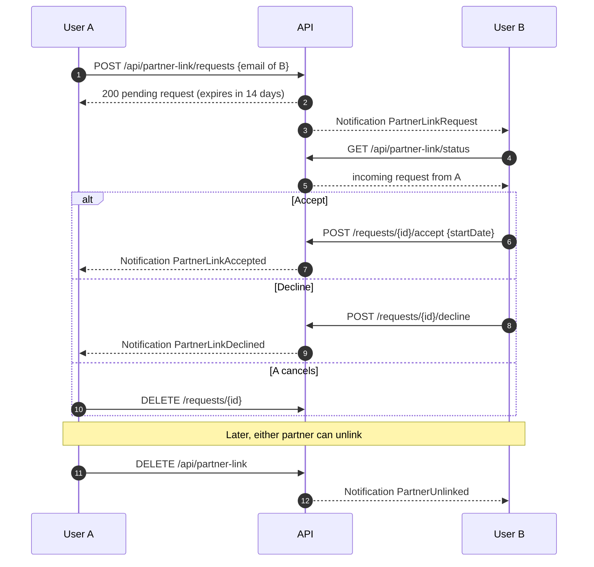

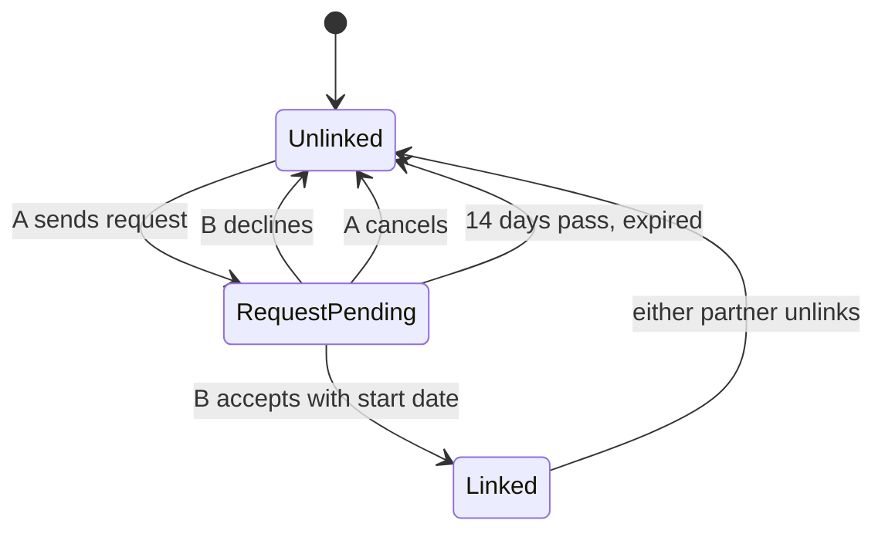

| ID | Requirement | Test focus / exact message |
|----|-------------|---------------------------|
| LINK-01 | Send by partner's account email; client validates format. | Bad format → Alert `"Check the email"`. Success overlay `"Link request sent"`. |
| LINK-02 | Server rejects: empty email, own email, unknown email, already-linked sender or target. | `"A partner email is required."`, `"You can't link to your own account."`, `"No account was found for '<email>'. Ask your partner to sign up first."`, `"You're already linked with a partner."`, `"That person is already linked with a partner."` |
| LINK-03 | Re-sending to the same person refreshes the 14-day expiry instead of creating a duplicate. | Two sends → one pending request. |
| LINK-04 | Incoming requests are shown above the send form ("Requests for you"). | |
| LINK-05 | Accept requires the relationship **start date**, not in the future. This drives "days together", anniversaries and milestones. | No date → Alert `"Pick a date"` / `"Choose the date the two of you got together."` |
| LINK-06 | Accepting an expired or already-handled request fails. | `"This link request has expired."`, `"This link request is no longer pending."`, `"The inviter's relationship is already full."` |
| LINK-07 | Unlink requires confirmation; on success Alert `"Unlinked"` / `"You are no longer linked with your partner."` | After unlink, partner-scoped screens show unlinked states. Not linked → `"You're not linked with a partner."` |
| LINK-08 | Link notifications are governed only by the master notifications switch (not "Partner activity"). | Turn off Partner activity → link requests still notify. |

**Endpoints:** `GET /api/partner-link/status`, `POST /api/partner-link/requests`, `POST /api/partner-link/requests/{id}/accept`, `POST /api/partner-link/requests/{id}/decline`, `DELETE /api/partner-link/requests/{id}`, `DELETE /api/partner-link`.

### 5.4 Notifications & push ✅

- **In-app inbox:** header bell → Notifications screen. Newest first, grouped **Today / Yesterday / Earlier**, pull to refresh. Each row has accessibility label `"<title>"` or `"<title>, unread"`. Mark one read on tap; "mark all read" available.
- **Unread badge:** one shared poller refreshes the inbox every **30 s** for every bell in the app.
- **Push:** Expo push tokens (APNs / FCM). Device registered after login (`platform` 1 = iOS, 2 = Android), removed on logout. Push is a **no-op on simulators/emulators** and when permission is denied — use physical devices for delivery tests.
- **In-app record is always created**, even when push is suppressed by a preference.

#### 5.4.1 Notification catalogue

Tapping is handled in **two places** with different code: the OS push banner (`App.tsx` / `pushHandlers.ts`) and a row in the in-app Notifications inbox (`NotificationsScreen.tsx`). They do not behave the same; test both.

| `type` | Trigger | Recipient | Push gated by | Push tap opens | Inbox row tap opens |
|--------|---------|-----------|---------------|----------------|---------------------|
| `Hug` | Partner sends a hug | Partner | Hug notifications | Hugs → HugSent | Hugs → HugSent |
| `Incident` | Assign/reassign, start investigation, awaiting response, resolved, closed, reopened, SLA breach | Other member (assignee for assign; **both** for SLA breach) | Master only | Desk → IncidentDetail | Desk → IncidentDetail |
| `LetsChat` | Partner sends a Let's Chat message (body never included) | Partner | Master only | Chat → ChatReceived | Chat → ChatReceived |
| `Gift` | Partner sends a vault gift | Partner | Partner activity | Vault, **auto-opens that gift** | Vault (gift **not** auto-opened) |
| `VisionBoardItemAdded` / `VisionBoardItemCompleted` | Partner adds / achieves a vision | Partner | Partner activity | Together → VisionBoardItemDetail | ⚠️ Nothing (inbox checks `VisionBoardItem`) — §9 BUG-12 |
| `MemoryAdded` | Partner adds a memory | Partner | Partner activity | Together → Memories | ⚠️ Nothing — §9 BUG-12 |
| `CalendarEventAdded` | Partner adds a calendar event | Partner | Partner activity | Together → Calendar | ⚠️ Nothing (inbox checks `CalendarEvent`) — §9 BUG-12 |
| `BucketListItemAdded` | Partner adds a bucket-list item | Partner | Partner activity | Together → DateIdeas (§9 BUG-11) | ⚠️ Nothing — §9 BUG-12 |
| `WishlistItemAdded` | Partner adds a wishlist item | Partner | Partner activity | Together → Wishlist | ⚠️ Nothing — §9 BUG-12 |
| `PartnerLinkRequest` | Link request received | Target | Master only | Profile → Link Partner modal | Profile → Link Partner modal |
| `PartnerLinkAccepted` / `PartnerLinkDeclined` / `PartnerUnlinked` | Link lifecycle | Other party | Master only | Nothing | Nothing |
| `PartnerActivity` | Support profile "notify partner" (API only, no UI) | Partner | Partner activity | Nothing | Nothing |
| `Emergency` | Emergency request (API only) | Partner | Emergency notifications | Nothing | Nothing |
| `CheckInReminder`, `DailyDigest` | Defined, but **no server code sends them** | — | Check-in reminders / Daily digest | — | — |

Every inbox tap marks the row read, even when it doesn't navigate.

**Push gating rule:** push is sent only if `notificationsEnabled` **and** legacy `pushNotificationsEnabled` are on, **and** the type's specific toggle (column above) is on. Types not listed fall back to the master switch.

**Local reminder:** the daily check-in reminder is a **local** notification scheduled on-device at the chosen `HH:MM` (Profile → Check-in reminders → Reminder time). It does not involve the server.

**Endpoints:** `POST /api/notifications/devices`, `DELETE /api/notifications/devices/{id}`, `GET /api/notifications`, `POST /api/notifications/{id}/read`, `POST /api/notifications/read-all`.

### 5.5 Media upload ✅

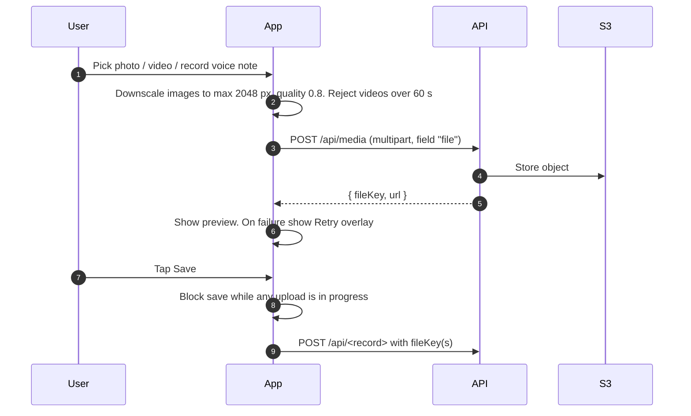

| ID | Requirement |
|----|-------------|
| MEDIA-01 | Allowed types: images `jpeg, jpg, png, webp, heic, heif, gif`; audio `m4a, x-m4a, mp4, aac, mpeg, mp3, wav, x-wav, webm, ogg`; video `mp4, quicktime, webm, 3gpp, x-matroska`. Others rejected. |
| MEDIA-02 | Server limit **100 MB** per file. nginx may reject earlier with HTML 413 → `"That file is too large to upload. Try a smaller image."` |
| MEDIA-03 | Videos longer than **60 s** are filtered out client-side with `"Videos must be 60 seconds or shorter."` |
| MEDIA-04 | Save is blocked while uploads run: `"Give the photos a moment to finish uploading."` (also voice-note and attachment variants). |
| MEDIA-05 | Failed upload shows a Retry overlay (accessibility label `"Retry upload"`); a photo can be removed (`"Remove photo"`). |
| MEDIA-06 | Photo-library permission denied → `"Could not access your library: …"` / `"Could not access photos: …"`. Microphone denied → `"Microphone access is needed to record a voice note."` |

### 5.6 Privacy & settings (affects partner-visible data)

All settings are booleans saved immediately via `PATCH /api/users/me/settings` (partial body).

| Group | Toggle (UI label → field) | Effect to verify |
|-------|---------------------------|------------------|
| Privacy & sharing | Share mood → `shareMood` | Off: partner's Home does not show your mood. |
| | Share activity → `shareActivity` | Off: `lastActiveAt` is null in partner's `GET /api/users/partner-status`. |
| | Share check-ins → `shareCheckIns`, Share location → `shareLocation`, Share timeline → `shareTimeline` | Persist; verify any partner-visible effect the product expects (no client gating found for these beyond persistence). |
| Permissions | Allow hugs → `allowHugs` | Off: partner's hug send fails 409 `"<YourName> is not accepting hugs right now."` |
| | Allow emergency alerts, Allow partner reminders | Persist only (features API-only). |
| Notifications | Enable notifications (master), Hug notifications, Emergency notifications, Check-in reminders (+ Reminder time), Partner activity, Daily digest | Gate push per §5.4.1. |
| App preferences | Sound effects, Vibration | Sounds / haptics on interactions. |

### 5.7 Enum encoding (high-value integration gotcha)

The API serialises enums as **string names** in responses for most features, but request payloads are inconsistent:

| Sent as **integers** | Sent as **string names** |
|----------------------|--------------------------|
| Mood check-in (`mood` 1–8, `checkInType`), Incident (category, impact, urgency), Memory category & media type, Vault create-gift category & media type | Splitting enums, Timeline event type, Chat template type & status, Support profile (visibility, options, boundary categories), Vision Board item type is decoded from either |

Assert payload shape in API-level tests and verify the UI renders both encodings where the client has decoders (Vision Board).

### 5.8 Data stored only on the device

These survive app restarts but **not** reinstall, and are not shared with the partner.

| Data | Store | Cleared on logout? |
|------|-------|--------------------|
| Access + refresh tokens | `@amori/auth-token`, `@amori/refresh-token` | Yes |
| Let's Chat local drafts (mirror of server draft + step index) | `@amori:chat:drafts` | **No** — `chatDraftStore.reset()` exists but isn't called (§9 BUG-06) |
| Splitting custom triggers | customTriggerStore | No |
| Daily gift pin for today + recent-gift history; "opened today" flag | dailyGiftStore, artifactStore | No |
| Theme preference | themeStore | No (device preference) |
| Check-in reminder schedule | expo-notifications (local) | No |

---

## 6. Feature requirements

### 6.1 Home / Sanctuary dashboard ✅

**Purpose:** Daily landing page that aggregates both partners' state and launches every hidden flow (§4.2).

**Content (top to bottom):** Support Profile banner (until complete) · couple header with **days together** and anniversary countdown · your mood and partner's mood · active **space window** card · quick actions · **Daily Gift** artifact · Monthly Memories widget · Weekly Reflection card (**Sundays only**).

| ID | Requirement | Test focus |
|----|-------------|-----------|
| HOME-01 | Days together and anniversary countdown derive from the relationship start date set at linking. | Unlinked user → no crash, graceful empty state. |
| HOME-02 | Shows your current mood and partner's current mood (`GET /api/moods/current`, `/partner-current`). | Partner `shareMood = off` → partner mood hidden. |
| HOME-03 | Space window card shows your own active space window, otherwise your partner's, with a live countdown. It stays visible for a **5-minute grace** after it ends. | Countdown accuracy; card disappears after grace. |
| HOME-04 | "×" on your own space window completes the splitting session (`POST /api/splitting/sessions/{id}/complete`) so it disappears on both dashboards. | Failure → `"Could not end your space. Please try again."` |
| HOME-05 | "Extend" adds **15 minutes from now** (`PATCH … {spaceEndsAt}`). | Failure → `"Could not extend your space. Please try again."` |
| HOME-06 | Background artwork is fixed per mount (not mood-driven). Check-in, Together and Desk backgrounds **do** follow the latest mood. | |
| HOME-07 | Each data card fails independently; one failing API must not blank the dashboard. | Block one endpoint (proxy) → rest still renders. |
| HOME-08 | Weekly Reflection card is shown only when the device's local day is Sunday. | Change device date to Sunday / Monday. |

### 6.2 Daily Gift (artifact) ✅ / ⚠️

**Purpose:** A daily collectible: one random **memory** or **uncompleted vision item** revealed as one of **10 card designs**.

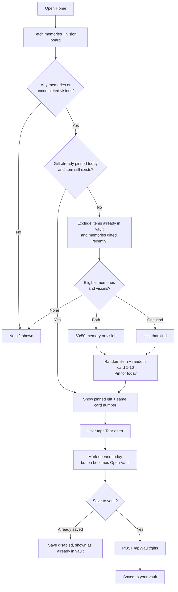

| ID | Requirement | Test focus |
|----|-------------|-----------|
| GIFT-01 | Gift is pinned per **local calendar day**: dashboard, High-Pleasant MoodGift screen and vault save all show the identical item and card. | Reopen app several times in one day → same gift. Midnight rollover → new pick. |
| GIFT-02 | Pinned item deleted or (vision) completed → re-roll and re-pin the same day. | Delete the pinned memory → new gift appears. |
| GIFT-03 | Prefer items not already in the vault and memories not gifted in recent days; relax recent-history first, then the vault filter, rather than show nothing. | Seed 1 memory only → it repeats daily. |
| GIFT-04 | No memories and no uncompleted visions → no gift. | Fresh relationship. |
| GIFT-05 | Memory gift body: description, `📍 location`, `🗓 <Month D, YYYY>`, `— <creator>`. Vision gift body: description, `📍`, `🎯 target date`, `💰 budget (USD)`, notes, `— <creator>`. | Field-by-field rendering incl. missing optional fields. |
| GIFT-06 | Tearing open (accessibility `"Tear open"`) marks it opened; the button persists as **Open Vault** for the rest of the day. | |
| GIFT-07 | Saving shows `"Saved to your vault"`; already-saved items cannot be saved again. Server save is idempotent. | Double-tap Save → one vault entry. Failure → `"Couldn't save to your vault"`. |
| GIFT-08 | ⚠️ Saving a **vision** gift currently fails (payload field mismatch). | See §9 BUG-02. |

### 6.3 Mood check-in ✅

**Entry:** Check-in tab; Home "Check in"; Weekly Reflection "Check in today".

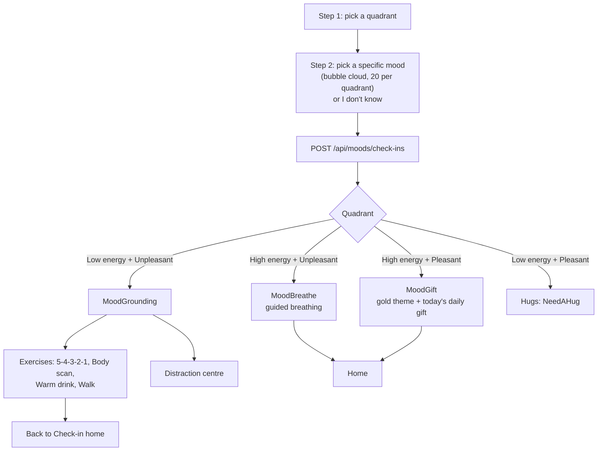

**Quadrants:** HIGH_PLEASANT "Pleasant & Energized" · LOW_PLEASANT "Pleasant & Calm" · HIGH_UNPLEASANT "Unpleasant & Stirred" · LOW_UNPLEASANT "Unpleasant & Drained".

**Backend mood enum (sent as integer):** Happy 1 · Calm 2 · Anxious 3 · Sad 4 · Angry 5 · Overwhelmed 6 · Numb 7 · Other 8. **CheckInType:** Morning 1 · Midday 2 · Evening 3 · AdHoc 4.

| Quadrant | UI moods (20 each) → backend mood |
|----------|----------------------------------|
| High + Pleasant | All 20 (Happy, Excited, Energized, Enthusiastic, Productive, Joyful, Thrilled, Inspired, Motivated, Optimistic, Proud, Cheerful, Confident, Hopeful, Eager, Curious, Amazed, Upbeat, Focused, Surprised) → **Happy** |
| Low + Pleasant | All 20 (Calm, Content, Peaceful, Relaxed, Comfortable, Loved, Grateful, Accepted, Secure, Valued, Blessed, Serene, Thankful, Satisfied, Relieved, Balanced, Mellow, Carefree, Thoughtful, Good) → **Calm** |
| High + Unpleasant | Angry: Enraged, Livid, Furious, Irate, Frustrated, Jealous, Irritated, Annoyed, Angry · Anxious: Terrified, Panicked, Frightened, Anxious, Apprehensive, Restless, Nervous · Overwhelmed: Stressed, Overwhelmed, Shocked, Tense |
| Low + Unpleasant | Sad: Sad, Lonely, Discouraged, Hopeless, Depressed, Miserable, Disappointed, Vulnerable, Guilty, Ashamed, Insecure · Numb: Numb, Tired, Fatigued, Exhausted, Burned Out, Disconnected, Apathetic, Bored, Meh |

| ID | Requirement | Test focus |
|----|-------------|-----------|
| MOOD-01 | Normal check-in sends `checkInType = AdHoc (4)`, the mapped mood int, `intensity = 5`, shared with partner. | Assert payload per mood in table above (data-driven test). |
| MOOD-02 | "I don't know" sends mood **Other (8)** and is **not** shared with partner. | Partner Home does not show it. |
| MOOD-03 | Server: intensity must be 1–10 → else 422 `"Intensity must be between 1 and 10."` | API test. |
| MOOD-04 | Post-check-in branch per quadrant (diagram). High + Pleasant applies the **gold theme**. | One test per quadrant. |
| MOOD-05 | If already checked in today, Check-in tab shows today's summary (MoodDetail) instead of the flow; resets on day rollover. | |
| MOOD-06 | Latest mood drives Check-in / Together / Desk backgrounds and the partner-mood widget. | |
| MOOD-07 | Grounding exercises each run to completion and return to Check-in home. | Timers, step progression, back navigation mid-exercise. |

**Endpoints used by app:** `POST /api/moods/check-ins`, `GET /api/moods/current`, `GET /api/moods/partner-current`. 🔌 API-only: list/get/patch/delete check-ins, `/share`, `/unshare`, `/history`, `/summary`.

### 6.4 Hugs ✅

**Entry:** Home "Send a hug"; Low + Pleasant check-in; Distraction "Send a gentle sign of peace"; Let's Chat received "Send a gentle hug"; Splitting PartnerDispatch; push tap.

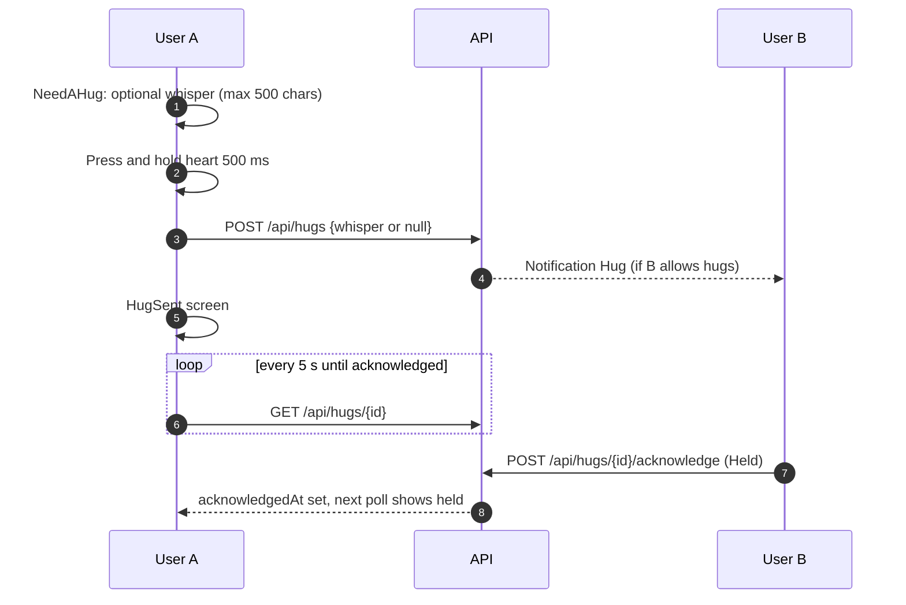

| ID | Requirement | Test focus / exact message |
|----|-------------|---------------------------|
| HUG-01 | Send requires a **long press of 500 ms** on the heart (accessibility `"Tap and hold to send a hug"`). Short tap does not send. | |
| HUG-02 | Whisper optional, max **500** chars with live `n/500` counter; trimmed; empty → null. | Boundary 500/501. |
| HUG-03 | Partner has `allowHugs = off` → 409 `"<PartnerName> is not accepting hugs right now."` | |
| HUG-04 | HugSent and BreatheTogether poll every **5 s** and stop on acknowledge and on unmount. | No polling after leaving screen. |
| HUG-05 | Only the recipient can acknowledge: else 401 `"Only the recipient can acknowledge a hug."` | |
| HUG-06 | History separates sent vs received; unacknowledged received hugs show a "Held" action. | |

**Endpoints:** `POST /api/hugs`, `GET /api/hugs`, `GET /api/hugs/{id}`, `POST /api/hugs/{id}/acknowledge`.

### 6.5 Let's Chat (guided messages) ✅ — new

**Purpose:** Help a partner put a feeling, need or appreciation into words using a template, preview the composed sentence, then send, or keep it private.

**Entry:** Home "Let's Chat"; `LetsChat` push tap (opens ChatReceived). ChatHome shows a Support Preferences link to the partner's handbook.

**Screens:** ChatHome (templates "Conversation starters", Drafts, History) → ChatCompose (one step per prompt) → ChatPreview → ChatSent ("Sent with love.") · ChatReceived · ChatDrafts · ChatHistory.

**Templates** (served by `GET /api/chat/templates`; all steps required):

| Type | Title | Steps (input → sentence prefix) |
|------|-------|--------------------------------|
| `Feeling` | Something I'm feeling | feeling → "I feel" · situation → "because of" · need → "and I needed" |
| `Appreciation` | Something I appreciate | person → "I appreciate" · action → "because" · reason → "and it meant" |
| `Need` | Something I need | need → "Right now I need" · reason → "because" |
| `SomethingBotheredMe` | Something that bothered me | situation → "Something that bothered me was" · feeling → "I felt" · desiredOutcome → "and I would like" |
| `SomethingOnMyMind` | Just something on my mind | thought → "Something on my mind is" |
| `Future` | Something about our future | goal → "I would love for us to" · reason → "because" |

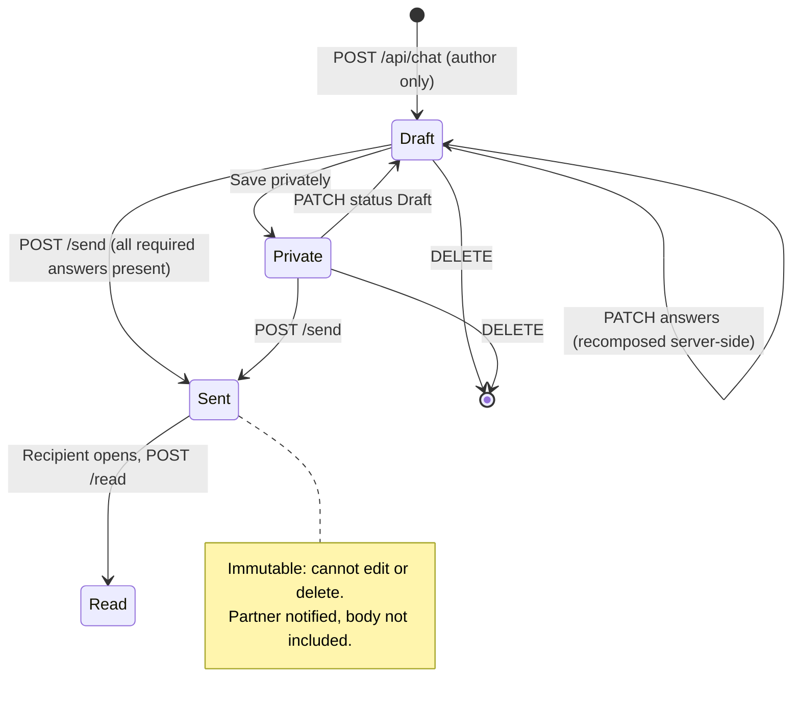

| ID | Requirement | Test focus / exact message |
|----|-------------|---------------------------|
| CHAT-01 | Each compose step's **Continue** is disabled until the current required answer is non-empty. | Whitespace-only answer keeps it disabled / is rejected. |
| CHAT-02 | Draft is saved both on the server and locally; it survives navigation, backgrounding and app restart, and resumes on the same step. | Kill app mid-compose → resume from ChatDrafts. Save failure → `"Could not save your draft. Check your connection and try again."` |
| CHAT-03 | Answers are trimmed; empty answers are dropped. The composed message is rebuilt on the server from answers. | Preview text == server `composedMessage`. |
| CHAT-04 | Preview shows "Private until you send it", with **Send to partner**, **Edit message**, **Save privately**. | |
| CHAT-05 | **Save privately** sets status `Private`, removes the local draft, overlay `"Saved privately"`, returns to ChatHome. | Partner never sees it. |
| CHAT-06 | **Send** is single-flight (double-tap guard). Server is idempotent: re-sending an already-sent message returns it unchanged and does not re-notify. | Rapid double tap → one notification. |
| CHAT-07 | Send validation: missing required answer → 422 `"Please complete every required field before sending."`; nothing composed → `"There's nothing to send yet."`; no partner → 409. | |
| CHAT-08 | Drafts and private messages are invisible to the partner: excluded from their list; direct GET returns 404. | B calls `GET /api/chat/{A's draft id}` → 404. |
| CHAT-09 | Only the author can edit/send/delete (401 `"Only the author can …"`). Sent messages: edit → 409 `"A sent message can no longer be edited."`, delete → 409 `"A sent message can no longer be deleted."` | |
| CHAT-10 | Recipient opening ChatReceived marks it read (status `Read`, `readAt` set once). Only the recipient can mark read; unsent → 409 `"This message hasn't been sent yet."` | |
| CHAT-11 | ChatReceived offers optional acknowledgement shortcuts: "I hear you", "Thank you for telling me", "I understand", "Tell me more". These show `"“<label>” shared."` **locally only — nothing is sent to the partner.** | Confirm product intent (§9 BUG-10). |
| CHAT-12 | ChatReceived "Reply with your own words" opens a new `SomethingOnMyMind` compose; "Send a gentle hug" sends a hug with no whisper (`"Hug sent ❤"`). | |
| CHAT-13 | Push for a sent chat: title `"A gentle thought for you ❤"`, body `"<Name> took a moment to put something into words for you."` (no message content). | Physical device. |
| CHAT-14 | History lists exchanged messages; own → ChatSent, partner's → ChatReceived. Empty: `"No messages exchanged yet."`; Drafts empty: `"No drafts yet."` | |

**Endpoints:** `GET /api/chat/templates`, `GET /api/chat`, `GET /api/chat/{id}`, `POST /api/chat {templateType, answers}`, `PATCH /api/chat/{id} {answers?, composedMessage?, status?}`, `POST /api/chat/{id}/send`, `POST /api/chat/{id}/read`, `DELETE /api/chat/{id}`.

### 6.6 Help Desk / Incidents ✅ / ⚠️

**Purpose:** Log relationship issues as "care tickets" with priority, SLA, assignment, conversation, resolution and retrospective.

**Entry:** Desk tab (HelpDesk); Home "Log incident"; `Incident` push tap → IncidentDetail.

**HelpDesk tabs:** Overview (summary stats + recent + overdue) · Open · Resolved · Overdue · Closed. Empty overview: title `"All clear"` with CTA `"Log an incident"`; other tabs: `"No incidents"`.
**IncidentList filter chips:** All · Open (`openOnly`) · Assigned to Me (`assignedToMe`) · Reported by Me (`reportedByMe`) · Resolved (`status=Resolved`). Server also supports `category`, `priority`, `overdue`, `page`, `pageSize`.

#### 6.6.1 Enumerations (sent as integers)

| Enum | Values |
|------|--------|
| Category | Communication 1 · Conflict 2 · Affection 3 · Trust 4 · Boundaries 5 · Plans 6 · Household 7 · EmotionalSupport 8 · Other 9 |
| Impact ("Emotional Impact") / Urgency ("Resolution Urgency") / Priority | Low 1 · Medium 2 · High 3 · Critical 4 |
| Status | Open 1 · Assigned 2 · Investigating 3 · AwaitingResponse 4 · Resolved 5 · Closed 6 · Reopened 7 |
| History action | Created 1 · Assigned 2 · CategoryChanged 3 · PriorityChanged 4 · StatusChanged 5 · InvestigationStarted 6 · NoteAdded 7 · ResponseRequested 8 · Resolved 9 · Closed 10 · Reopened 11 · ReviewAdded 12 · LessonAdded 13 · ResponseAdded 14 · Updated 15 |

#### 6.6.2 Priority matrix (server-calculated) and SLA

| Impact ↓ / Urgency → | Low | Medium | High | Critical |
|---|---|---|---|---|
| **Low** | Low | Low | Medium | High |
| **Medium** | Low | Medium | High | Critical |
| **High** | Medium | High | High | Critical |
| **Critical** | High | High | Critical | Critical |

| Priority | SLA (`dueAt = createdAt + …`) |
|----------|-------------------------------|
| Critical | 4 hours |
| High | 24 hours |
| Medium | 3 days |
| Low | 7 days |

- `isOverdue` = now > dueAt **and** status is not Resolved/Closed. `remainingSeconds` floors at 0.
- Changing impact/urgency via PATCH recalculates priority and `dueAt` from the original `createdAt`.
- **SLA monitor** scans every 5 min; on first breach it notifies **both** partners once: `"A care ticket has passed its SLA"` / `"#<ID8> · <title> is now overdue and needs attention."` Reopen clears the breach stamp so a later breach notifies again.
- The app's SLA countdown ticks locally between refreshes.

#### 6.6.3 Status state machine (server-enforced)

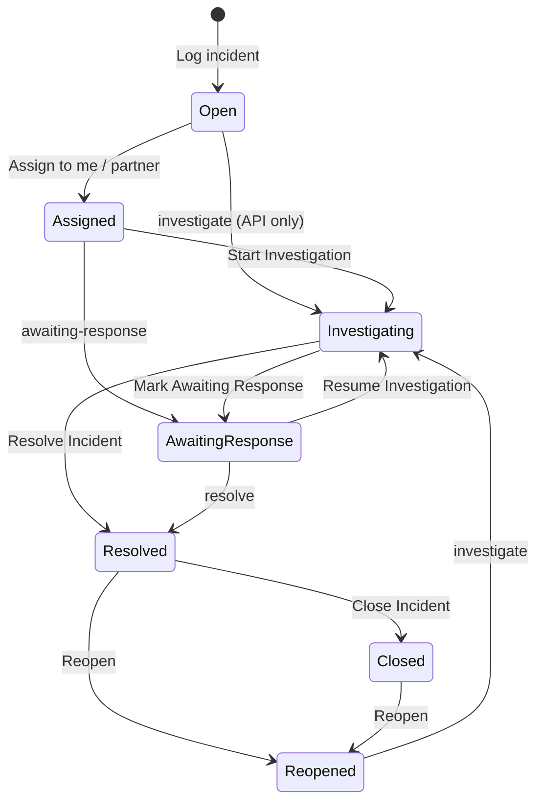

Invalid transitions → **422** `"Cannot transition from '<Current>' to '<Next>'. Allowed transitions from '<Current>': <list>."`

#### 6.6.4 Detail screen action buttons by status (UI)

| Status | Buttons shown | Server outcome |
|--------|---------------|----------------|
| Open | Assign to Me · Assign to Partner (only if partner linked; confirm dialog "Reassign to partner?") | → Assigned |
| Assigned | Start Investigation · Reassign to Partner | → Investigating / assignee changes, status unchanged |
| Investigating | Add Response · Add Investigation Note · Mark Awaiting Response · Reassign to Partner · Resolve Incident | as diagram |
| **Reopened** | **Same buttons as Investigating** | ⚠️ "Mark Awaiting Response" and "Resolve" are **rejected** (Reopened → Investigating only). No "Start Investigation" button. See §9 BUG-04. |
| AwaitingResponse | Add Response · Resume Investigation · Reassign to Partner | |
| Resolved | Close Incident · Write Review · Reopen | |
| Closed | View Lessons Learned · Write Review · Reopen | |

#### 6.6.5 Forms

| Screen | Fields (max length) | Rules / messages |
|--------|--------------------|------------------|
| LogIncident (5-step wizard: What happened → Category & Context → How serious → Who will steward → Review & Submit) | Title * (300), Description (4000), Category *, Sub-category (100), Emotional Impact *, Resolution Urgency *, Assignee (partner option disabled with `"Link a partner first to use this"`) | Server: empty title → 422 `"Title is required."` Success overlay `"Incident logged"`. |
| AddResponse | Content * | `"Response added"` |
| AddNote | Content * | `"Note added"` |
| ResolveIncident | Resolution * (2000), Notes (2000) | |
| CloseIncident | Closure notes (2000) | |
| ReopenIncident | Reason * (2000) | |
| IncidentReview | 3 optional reflection fields (2000 each) | Only after Resolved/Closed → else 409 `"Reviews can only be added after an incident is resolved or closed."` `"Review saved"` |
| IncidentLessons | Lesson (1000) | `"Lesson saved"` |

#### 6.6.6 Rules

| ID | Requirement | Test focus / exact message |
|----|-------------|---------------------------|
| INC-01 | Required on create: title, category, impact, urgency. Priority and dueAt are derived server-side. | Data-driven test over the 16 matrix cells; assert `priority` and `dueAt`. |
| INC-02 | Assign only to a member of your relationship → else 401 `"Can only assign to a member of your relationship."` | |
| INC-03 | Reassign to partner: no partner → 409; already assigned to partner → 409 `"This incident is already assigned to your partner."` Partner notified `"A care ticket was reassigned to you"`. | |
| INC-04 | Status changes notify the **other** partner: `"Care ticket status changed"`, `"A care ticket needs your response"`, `"A care ticket was resolved"`, `"A care ticket was closed"`, `"A care ticket was reopened"`. | |
| INC-05 | Notes and responses: only the author can edit/delete → 401 `"Only the author can edit this note."` etc. | |
| INC-06 | Every action writes a history entry (see enum). | `GET /api/incidents/{id}/history` after each action. |
| INC-07 | Summary (`GET /api/incidents/summary`) feeds HelpDesk Overview counts. | Counts match list filters. |
| INC-08 | Detail failures: generic `"Sorry that failed :("`; assign-to-me failure → Alert `"Error"` / `"Could not assign incident."` | |

**Endpoints (base `/api/incidents`):** `POST /`, `GET /` (filters), `GET /summary`, `GET|PATCH /{id}`, `POST /{id}/assign {userId}`, `/reassign`, `/investigate`, `/awaiting-response`, `/resolve {resolution, notes?}`, `/close {notes?}`, `/reopen {reason}`, `GET|POST /{id}/notes`, `PATCH|DELETE /{id}/notes/{noteId}`, `GET|POST /{id}/responses`, `PATCH|DELETE /{id}/responses/{responseId}`, `GET /{id}/history`, `GET /{id}/sla`, `POST /{id}/review`, `GET|POST /{id}/lessons`.

### 6.7 Together hub ✅

**Purpose:** Shared space for planning and collecting. The Together tab is a scrolling dashboard plus a top tab strip.

**Top tabs** (accessibility label = tab text): **Us** → VisionBoard · **Calendar** → Calendar · **Date Ideas** → DateIdeas · **Bucket List** → scrolls to the inline collections section · **Wishlist** → Wishlist · **Important Dates** → ImportantDates.

**Dashboard sections:** couple header + countdown note → Vision Board card → Shared Calendar card (month grid, prev/next month, add event, tap a day → CalendarDay, **Add anniversaries**) → Shared Collections (bucket list + to-do list inline) → Memories card (Memories, Relationship timeline) → Private repositories (Wishlist, Date Ideas previews). Pull-to-refresh supported.

#### 6.7.1 Shared calendar

| ID | Requirement | Test focus / exact message |
|----|-------------|---------------------------|
| CAL-01 | Month view lists events via `GET /api/calendar/events?year=&month=` (**month is 1-indexed**). Important dates are overlaid. | Month boundaries, Dec → Jan year change. |
| CAL-02 | Add/Edit event: Title * (`"Give the event a title."`), Date, optional "Set a time" with Starts/Ends, Location (optional), Notes (optional), **Remind us** = 60 min before. | End ≤ start → `"The end time has to be after the start time."` Success `"Event created"` / `"Event saved"`. |
| CAL-03 | Only the creator can update or delete → 401 `"Only the creator can update this event."` / `"…delete this event."` | B opens A's event → no destructive success. |
| CAL-04 | CalendarDay shows the day's events (timed and **ALL DAY**), a **Today** jump and "Add an event on this day". | |
| CAL-05 | **Add anniversaries** builds events from the relationship start date: relationship < 1 year → monthly "monthiversaries" up to and including the first anniversary; ≥ 1 year → next **5** yearly anniversaries. Deduped against existing events; reminder 1 day before. | No start date → `"Add your relationship start date first."` Second tap → `"Your anniversaries are already on the calendar."` |
| CAL-06 | Creating an event notifies partner (`CalendarEventAdded`). | |
| CAL-07 | ⚠️ Reminder settings are stored but **no server job or local schedule delivers them**. | See §9 BUG-09. |

**Endpoints:** `GET/POST /api/calendar/events`, `GET/PATCH/DELETE /api/calendar/events/{id}`, 🔌 `POST /api/calendar/events/{id}/complete`. Recurrence enum (API): None 0 · Weekly 1 · Monthly 2 · Yearly 3.

#### 6.7.2 Important dates

| ID | Requirement | Test focus / exact message |
|----|-------------|---------------------------|
| IMP-01 | Add: occasion name * ("What's the occasion?"), date ("Pick a date"), **Repeats every year** toggle. | Server: empty → 422 `"Name is required."` Success `"Date added"`. |
| IMP-02 | Only the creator can update/delete → 401 `"Only the creator can update this."` / `"…delete this."` | |

**Endpoints:** `GET/POST /api/important-dates`, `GET/PATCH/DELETE /api/important-dates/{id}`.

#### 6.7.3 Bucket list & to-do list (inline on Together)

Both are bucket-list items; the to-do list uses category `ToDoList (7)`. Categories: Travel 1 · Adventure 2 · Food 3 · Romantic 4 · Personal 5 · Fun 6 · ToDoList 7 · DateIdeas 8.

| ID | Requirement | Test focus / exact message |
|----|-------------|---------------------------|
| BKT-01 | Add item (title required → 422 `"Title is required."`). | `"Added to your bucket list"` / `"To-do added"` |
| BKT-02 | Toggle complete (`POST /{id}/complete`). Either partner can complete. | |
| BKT-03 | Delete: **owner only** → 401 `"Only the owner can delete this item."` | |
| BKT-04 | Adding notifies partner (`BucketListItemAdded`). | |

**Endpoints:** `GET/POST /api/bucket-list`, `GET/PATCH/DELETE /api/bucket-list/{id}`, `POST /{id}/complete`, 🔌 `POST /{id}/favorite`.

#### 6.7.4 Date ideas

| ID | Requirement | Test focus / exact message |
|----|-------------|---------------------------|
| DATE-01 | Add idea via "Add a date idea..." input + Save. Title required. | `"Date idea added"` |
| DATE-02 | Mark complete (one-way), favourite via PATCH, delete (**creator only**: `"Only the creator can delete this."`). | |
| DATE-03 | **Random pick** (`POST /api/dates/random`) returns an uncompleted idea, or **204/null** when none exist. | Empty list → graceful "nothing to pick" state. |
| DATE-04 | "Use their preferences" link opens the partner's How to Know Me handbook. | |

Date categories (API): Romantic 1 · AtHome 2 · GoingOut 3 · Adventure 4 · Food 5 · CheapOrFree 6 · Weekend 7 · Holiday 8.

**Endpoints:** `GET/POST /api/dates`, `GET/PATCH/DELETE /api/dates/{id}`, `POST /{id}/complete`, `POST /api/dates/random`, 🔌 `GET /api/dates/categories`.

#### 6.7.5 Shared wishlist

| ID | Requirement | Test focus / exact message |
|----|-------------|---------------------------|
| WISH-01 | Add item via "Add to Wishlist..." + Save. Name required → 422 `"Name is required."` | `"Added to your wishlist"` |
| WISH-02 | Purchased / favourite toggled via PATCH or `/complete`, `/favorite`. | |
| WISH-03 | Update and delete: **owner only** → 401 `"Only the owner can update this item."` / `"…delete this item."` | |
| WISH-04 | Adding notifies partner (`WishlistItemAdded`). | |

Priority enum: Low 1 · Medium 2 · High 3. **Endpoints:** `GET/POST /api/wishlist`, `GET/PATCH/DELETE /api/wishlist/{id}`, `POST /{id}/complete`, `POST /{id}/favorite`.

### 6.8 Vision Board ("Us") ✅ — new

**Purpose:** A shared board of dreams and goals, grouped into sections ("shelves"). Owned by the relationship, so **either partner can edit, move, complete or delete any item**.

**Entry:** Together "Us" tab or Vision Board card; `VisionBoardItem*` push tap → VisionBoardItemDetail.

**Default sections** (seeded the first time the board is opened; never re-seeded if all are later deleted):

| Order | Section | Item type it receives by default |
|-------|---------|----------------------------------|
| 1 | Our Dreams — "Aspirations and inner callings." | Dream (1) |
| 2 | Our Places — "Corners of the earth to roam." | Place (2) |
| 3 | Our Home — "Sanctuary aesthetics and hearth." | Home (4) |
| 4 | Our Experiences — "Things to feel and do together." | Experience (3) |
| 5 | Our Future — "Long horizons and legacies." | Future (5) |
| 6 | Our Little Things — "Daily joys and cozy whimsies." | LittleThing (6) |
| — | Custom sections (user-created, sorted after defaults) | Custom (7) |

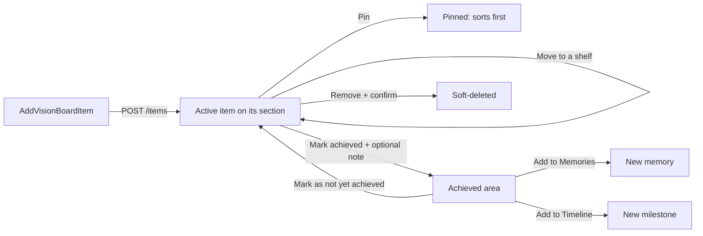

| ID | Requirement | Test focus / exact message |
|----|-------------|---------------------------|
| VIS-01 | Add item fields: VISION TITLE * (`"Give it a title."`), VISUAL ANCHOR (photo, 2048 px), VISION ESSENCE (type), DESCRIPTION & FEELING, LOCATION, TARGET HORIZON (date, placeholder "Someday"), TARGET BUDGET (number), INSPIRATION / LINK, NOTES. | Success `"Added to your vision"`; edit `"Vision saved"`. Uploading → `"Give the photo a moment to finish uploading."` |
| VIS-02 | No section chosen → item lands in the default section for its type. Unknown section id → 404. | |
| VIS-03 | Active ordering: pinned first, then sort order. Completed items move to an "Achieved" area. | |
| VIS-04 | Mark achieved (optional "How it felt, where you were…" note) → overlay `"We did it ❤"`; partner notified `VisionBoardItemCompleted`. | |
| VIS-05 | From an achieved item: **Add to Memories** (`"Added to Memories"`) and **Add to Timeline** (`"Added to Timeline"`). | New record appears in the target feature with item data. |
| VIS-06 | Remove asks for confirmation ("Remove from vision") → `"Removed"`. | |
| VIS-07 | Sections: create (name required → `"Name is required."`), rename (empty → `"Name cannot be empty."`), reorder, delete. Deleting the last section → 409 `"You can't delete your last section. Add another first, or move its items."` | |
| VIS-08 | Adding an item notifies partner `VisionBoardItemAdded`. | |
| VIS-09 | Item type may come back as int or string; UI decodes both, defaulting to Dream. | |
| VIS-10 | Load failure → `"Could not load your Vision Board. Pull to refresh or try again."` | |

**Endpoints:** `GET /api/vision-board`, `GET/PATCH/DELETE /api/vision-board/items/{id}`, `POST /items`, `POST /items/{id}/complete`, `/uncomplete`, `/move {sectionId}`, `/pin`, `POST /items/reorder`, `GET/POST /sections`, `PATCH/DELETE /sections/{id}`, `POST /sections/reorder`.

### 6.9 Memories ✅

**Purpose:** Shared photo/video/voice/link memories with date, place and category.

**Entry:** Together → Memories card; Home Monthly Memories widget; `MemoryAdded` push tap → Memories. **Screens:** Memories ("Our Story", search "Search memories, categories, tags…", empty CTA "Add your first") · AddMemory (create/edit) · MonthlyMemories (month browser) · MemoryMap (single memory pin, **Open in Maps**) · RelationshipTimeline · MemoryDetail modal · full-screen image viewer.

**AddMemory fields:**

| Field | Required | Notes |
|-------|----------|-------|
| Title | ✅ | Placeholder "e.g. Sunset in Santorini". Empty → `"Give the memory a title."` |
| Category | ✅ (defaulted) | Everyday 1 · Trip 2 · Date 3 · Milestone 4 · Adventure 5 · Celebration 6 (sent as int) |
| Date (+ time) | ✅ | Picker capped at **today** (no future). Server: missing → `"A date and time for the memory is required."` |
| Location (optional) | — | Location picker with geocoding; stored as name + lat/lng. |
| Notes (optional) | — | "What made this moment special?" |
| Photos & videos (optional) | — | Multi-select. Images downscaled; videos ≤ 60 s. Upload immediately with Retry. |
| Voice note (optional) | — | In-app recorder. Errors: `"Microphone access is needed to record a voice note."`, `"Could not start recording."`, `"The recording was empty."`, `"Could not save the recording."`. Playback error `"Could not play this voice note."` |
| Link (optional) | — | URL + optional title. Invalid → `"That link doesn’t look like a valid URL."` |

Media types: Photo 1 · VoiceNote 2 · Link 3 · Video 4.

| ID | Requirement | Test focus / exact message |
|----|-------------|---------------------------|
| MEM-01 | Save blocked while any photo/video/voice note is uploading (MEDIA-04). | |
| MEM-02 | Edit preloads the memory and attaches only **new** media keys; existing media can be removed (`DELETE /{id}/media/{mediaId}`). | No duplicate media after edit. |
| MEM-03 | Update/delete: **creator only** → 401 `"Only the creator can update this memory."` / `"…delete this memory."` | B tries to edit A's memory. |
| MEM-04 | Delete from list or MonthlyMemories (confirm "Delete memory") → `"Deleted!"`; failure `"Sorry that failed :("`. | |
| MEM-05 | Favourite / unfavourite. | `POST` / `DELETE /{id}/favorite` |
| MEM-06 | Creating notifies partner `MemoryAdded`. | |
| MEM-07 | Gift-only memories created by Send-a-Gift (§6.13) do **not** appear in the Memories feed. | Send a gift → Memories list unchanged. |

**Endpoints:** `GET/POST /api/memories`, `GET/PATCH/DELETE /api/memories/{id}`, `POST/DELETE /api/memories/{id}/favorite`, `POST /api/memories/{id}/media {fileKey, mediaType…}`, `DELETE /api/memories/{id}/media/{mediaId}`.

### 6.10 Timeline (relationship milestones) ✅

**Entry:** Together → Memories card "Open the relationship timeline" (hidden Timeline tab).

| ID | Requirement | Test focus / exact message |
|----|-------------|---------------------------|
| TL-01 | Create: title * (max **120**, `"Give the milestone a title."`), description (max **1000**), event date (`YYYY-MM-DD`), optional location, event type, photos. | Uploading → `"Give the photos a moment to finish uploading."` |
| TL-02 | Event type sent as **string**: FirstConversation · FirstDate (UI default) · FirstKiss · FirstTrip · Anniversary · Custom (server default). | |
| TL-03 | Update, delete, add/remove photos: **creator only** → 401 `"Only the creator can …"`. Remove photo uses `DELETE /api/timeline/{id}/media?photoKey=`. | |
| TL-04 | Delete confirm ("Delete milestone") → `"Deleted!"`. | |

**Endpoints:** `GET/POST /api/timeline`, `GET/PATCH/DELETE /api/timeline/{id}`, `POST /api/timeline/{id}/media {photoKey}`, `DELETE /api/timeline/{id}/media?photoKey=`.

### 6.11 Splitting ("I'm Splitting" / SOS) ✅

**Purpose:** A guided de-escalation flow for moments of emotional overwhelm. It records a session (triggers, needs, mood) and can set a **space window** both partners see.

**Entry:** Home SOS; Desk stack (Splitting). The intro screen also links to support preferences.

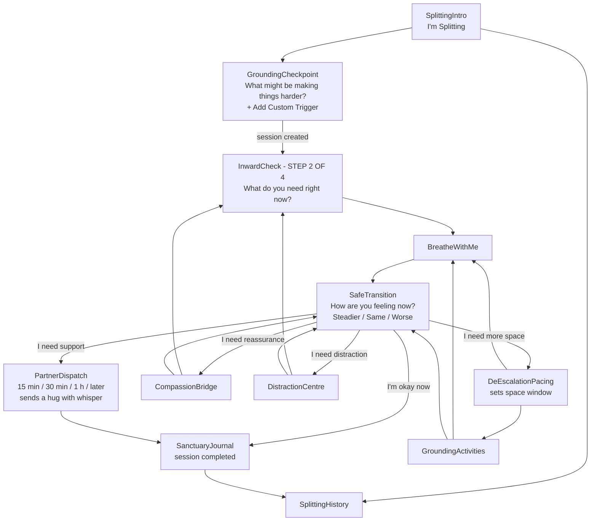

| ID | Requirement | Test focus / exact message |
|----|-------------|---------------------------|
| SPL-01 | A backend session is created when the user passes GroundingCheckpoint (feelings/triggers); InwardCheck adds "what I need". Enums are sent as **string names**. | `POST /api/splitting/sessions` payload. |
| SPL-02 | Custom triggers are saved **locally on the device** (name + category) and reused in later sessions. | Reinstall clears them. |
| SPL-03 | Space window durations: 15, 30, 60 minutes, or "later" (no window). `spaceEndsAt` is persisted so the countdown survives app restart. | Kill app mid-countdown → resumes. |
| SPL-04 | Partner sees a privacy-safe active window via `GET /partner-active` (204 → none) on their Home (§6.1 HOME-03). | Two-device test. |
| SPL-05 | PartnerDispatch sends a **hug** with a pre-written or chosen space message (counts as a Hug notification). | B receives Hug push/inbox. |
| SPL-06 | Leaving the flow at any point after GroundingCheckpoint completes the session best-effort, so it appears in history. A second completion returns 409 and is ignored silently. | Back out mid-flow → session in history. |
| SPL-07 | SanctuaryJournal completes with a final mood and can save a journal description (`PATCH {description}`). | |
| SPL-08 | Only in-progress sessions can be updated/completed/cancelled → 409 `"Only in-progress sessions can be …"`. | |
| SPL-09 | Some Splitting copy (SafeTransition options, PartnerDispatch) uses the fixed placeholder **"Your love"** instead of the partner's real name, e.g. "Read Your love's stored grounding notes". | Confirm intended copy with product. |

**Endpoints (base `/api/splitting/sessions`):** `POST /`, `GET /`, `GET /{id}`, `PATCH /{id}`, `POST /{id}/complete`, `POST /{id}/cancel`, `GET /partner-active`.

### 6.12 Distraction centre ✅

**Entry:** Home "Distraction"; MoodGrounding; Splitting DistractionCentre.

| Game | Behaviour | Validation / messages |
|------|-----------|-----------------------|
| **Spot the Hidden Number** ("Begin a round") | *Quick number round*: tap the target number in a grid → `"Found it — nicely spotted."` *Puzzles from the two of you*: a partner uploads a photo, hides a number **0–99** at a tapped point; the other finds it by tapping → `"You found it."` The author sees their own answer and cannot play it. | `"Choose a photo first."`, `"Give the photo a moment to finish uploading."`, `"Pick a number between 0 and 99 to hide."`, `"Tap the photo to place the number."`; success `"Puzzle created"`. Server: `"An image is required."`, `"Tell your partner what to look for."`, `"The target must be inside the image."` (normalised x/y 0–1). Only creator can delete. |
| **Amari 2048 · Constellations** | Client-side 4×4 2048 ("Start a new game"). Play is recorded via start/complete session calls that never block play. | `POST /api/games/{id}/sessions`, `POST /api/games/sessions/{id}/complete`. Session not in progress → 409. |
| **"About Us" Couple Quiz** | Answer today's questions, "See our score" → `score / totalQuestions`. Author new questions in QuizComposer. | Client: `"Add a question."`, `"Add at least two options."`, `"Mark which option is the correct answer."`; success `"Question added"`. Server: `"A question is required."`, `"Provide at least two options."`, `"A correct answer is required."`, `"The correct answer must be one of the options."`, `"At least one answer is required."` |
| **Would You Rather** | Pick option A/B, see both partners' choices; author prompts. | Server `"Both options are required."`; success `"Prompt added"`. |
| **DBT Somatic Regulation Suite** | Guided exercises: Cold reset (TIPP), Paced breathing, 5-4-3-2-1 grounding, Paired muscle release. Client-only. | |
| **Send a gentle sign of peace** | Opens Hugs → NeedAHug. | |

**Endpoints:** `GET /api/games`, `GET /api/games/{id}`, `POST /api/games/{id}/sessions`, `POST /api/games/sessions/{id}/complete`, `GET /api/games/history`, `GET/POST /api/quiz/questions`, `POST /api/quiz/sessions`, `GET /api/quiz/history`, `GET/POST /api/would-you-rather/questions`, `POST /api/would-you-rather/questions/{id}/answer {choseOptionA}`, `GET/POST /api/hidden-object-puzzles`, `DELETE /api/hidden-object-puzzles/{id}`.

### 6.13 Vault (Hearth Vault) & Send-a-Gift ✅ / ⚠️

**Purpose:** Each user's **private** collection of saved cards (memories or vision items), plus the ability to compose a gift and drop it into the partner's vault.

**Entry:** Home "View vault" / "Open Vault"; `Gift` push tap (opens Vault and auto-opens that gift).

**Screen content:** level progress bar · badge collection · gift cards in **deck** view (default) or **list/grid** view · "Send a gift" button (accessibility `"Send a gift to your partner"`) · weekly reflection links (`"Open weekly reflection"`, saved reflections → archive). Empty state `"Your Vault is empty"`; load error with **Try Again**.

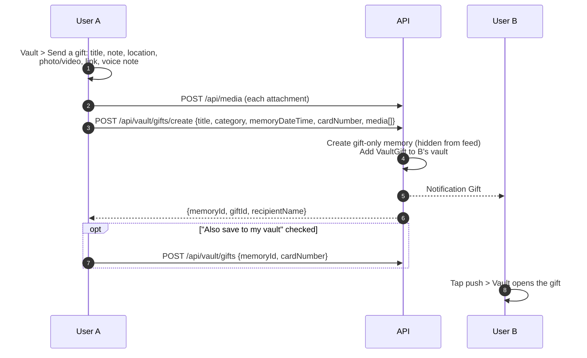

| ID | Requirement | Test focus / exact message |
|----|-------------|---------------------------|
| VAULT-01 | Vault is per-user and private. Reading a partner's gift id returns **404** (not 401) so ids can't be probed. | B `GET /api/vault/gifts/{A's gift}` → 404. |
| VAULT-02 | Save requires exactly one of `memoryId` / `visionBoardItemId`, and `cardNumber` 1–10. | `"Either MemoryId or VisionBoardItemId is required."`, `"Provide either MemoryId or VisionBoardItemId, not both."`, `"CardNumber must be between 1 and 10."` |
| VAULT-03 | Saving the same memory/vision twice returns the existing entry (idempotent). | |
| VAULT-04 | Only items from your own relationship can be saved → else 401. | |
| VAULT-05 | Send-a-Gift: title required (`"Give your gift a title."`); attachments must finish uploading (`"Give the attachments a moment to finish uploading."`); video ≤ 60 s; valid URL. | |
| VAULT-06 | Success overlay `"Gift sent to <Name> 🎁"` or, with "Also save to my vault", `"Gift sent to <Name> and saved to your vault 🎁"`. Failure `"Couldn't send gift"`. | |
| VAULT-07 | No partner → 409 `"Your relationship does not have a second partner yet."` | |
| VAULT-08 | Gift-only memories do not appear in Memories (MEM-07). | |
| VAULT-09 | Remove a gift from your vault (`DELETE /api/vault/gifts/{id}`). | |
| VAULT-10 | ⚠️ Vision-based gifts can't be saved/excluded correctly due to a field-name mismatch. | §9 BUG-02 |

**Endpoints:** `GET /api/vault/gifts`, `GET /api/vault/gifts/{id}`, `POST /api/vault/gifts`, `POST /api/vault/gifts/create`, 🔌 `POST /api/vault/gifts/send {memoryId|visionBoardItemId, cardNumber}` (send an existing item; not used by the app), `DELETE /api/vault/gifts/{id}`.

### 6.14 Weekly Reflection ✅ / ⚠️ — new

**Purpose:** A Monday–Sunday retrospective ("SANCTUARY RETROSPECTIVE · Your Week") with daily mood rhythm, dominant mood and moments captured. Users can keep ("hold") a snapshot.

**Entry:** Home card (Sundays only); Vault "Open weekly reflection"; Vault → saved reflections → WeeklyReflectionArchive → a saved week.

| ID | Requirement | Test focus / exact message |
|----|-------------|---------------------------|
| WR-01 | Week = Monday 00:00 → Sunday 23:59:59.999 **local time**; day strip MON…SUN. If several check-ins land on one day, the latest wins. | Check-ins at 23:59 Sunday vs 00:00 Monday. |
| WR-02 | Cards: DAILY RHYTHM, DOMINANT MOOD, MOMENTS CAPTURED. No data → `"A Quiet Week"` with `"Check in today"` (→ Check-in). | |
| WR-03 | Save → `POST /api/weekly-reflections` with `weekKey` (`YYYY-MM-DD`, the Monday) and `rangeLabel`; overlay `"Held in your Sanctuary"`. | Server: `"WeekKey is required."`, `"WeekKey must be a date in the form YYYY-MM-DD."`, `"RangeLabel is required."` |
| WR-04 | Archive lists saved weeks; opening one shows "Saved Reflection" / "KEPT REFLECTION" with the stored snapshot (not live data). Deleted/missing → `"This reflection is no longer saved."` | |
| WR-05 | ⚠️ Mood distribution only reflects the **latest** check-in, because there is no date-range mood endpoint wired. | §9 BUG-05 |

**Endpoints:** `GET /api/weekly-reflections`, `GET /api/weekly-reflections/{weekKey}`, `POST /api/weekly-reflections`, `DELETE /api/weekly-reflections/{weekKey}`.

### 6.15 How to Know Me (Support Profile) ✅ — new

**Purpose:** Each partner fills a 7-section handbook so the other knows how to support them. Every field has its own **Shared / Private** visibility (default **Shared**). The partner gets a read-only view of shared, non-empty fields only.

**Entry:** Profile → SUPPORT PREFERENCES → **How to Know Me**; Home banner `"Finish your “How to Know Me”"` (kicker "GETTING TO KNOW YOU", CTA "Continue →") until all 7 sections have content; Support Preferences links on Let's Chat home, Date Ideas ("Use their preferences") and Splitting intro → partner's handbook. SupportProfileHome has `"See your partner’s handbook →"`.

| # | Section (key) | Field type | Fields |
|---|---------------|-----------|--------|
| 1 | Who I Am (`whoIAm`) | text | Nickname, How I describe myself, What's important to me, What makes me feel like myself, What I'm proud of, What I'm working toward, What I wish people understood |
| 2 | What I Like (`whatILike`) | lists | Hobbies, Activities, Date preferences, Music, Movies, Shows, Books, Games, Food, Places |
| 3 | My Favorites (`favorites`) | text | Colour (+ hex swatch), Food, Drink, Snack, Restaurant, Place, Flower, Animal, Movie, Song, Artist, Season, Holiday, Smell, Activity |
| 4 | How to Help Me (`howToHelpMe`) | text + options | When I'm having a difficult day, What to avoid, Reassurance that works, How to approach me, How I ask for space, What helps me recover, Never assume · Support options (multi-select): Give me space to settle, Stay close by, Reassure me, Just listen, Help me solve it, Distract me, Make me laugh, Physical affection, Check in on me later, Ask what I need · Custom options · one visibility for all options |
| 5 | Things to Know (`thingsToKnow`) | lists | Stressors, Comforts, What makes me feel appreciated, What makes me feel ignored, Important routines, Important dates, Sensitivities, Things to remember |
| 6 | My Boundaries (`boundaries`) | per category: Comfortable with / Ask before / Please don't + visibility | Communication & Messaging, Personal Space & Solitude, Physical Affection & Touch, Social Situations, Time Together, Conflict & Disagreements, Privacy |
| 7 | My Little Things (`littleThings`) | text | Usual coffee order, Comfort food, Comfort movie, What makes me smile, Guilty pleasure, Always losing, Could talk about forever, Tiny thing that makes my day, Secretly love |

| ID | Requirement | Test focus / exact message |
|----|-------------|---------------------------|
| SP-01 | Profile is auto-created empty on first read. | New user `GET /api/support-profile/me` → 200, 0%. |
| SP-02 | **Completion** = sections with at least one non-blank value ÷ 7, rounded (0, 14, 29, 43, 57, 71, 86, 100 %). Favourite-colour hex alone doesn't count; whitespace doesn't count; selecting a support option counts. | One test per section + boundary cases. |
| SP-03 | Each section saves with a **partial PATCH** to its own endpoint; only sent fields change. | Edit one field → others unchanged. |
| SP-04 | Partner view (`GET /api/support-profile/partner`) includes only **Shared** fields with values. A section with nothing shared shows `"They haven’t shared this yet."` | Mark a field Private → disappears for partner. |
| SP-05 | Enum values are sent as **string identifiers** (e.g. `GiveSpace`, `PersonalSpace`, `Shared`), never display labels. | |
| SP-06 | Save failure Alert `"Could not save"` with: 404/501 → `"This feature isn’t available on the server yet. Please try again after the next update."`; other HTTP → `"Couldn’t save (server error <code>). Please try again."`; network → `"Please check your connection and try again."` | |
| SP-07 | Field edits **never** notify the partner. (`POST /me/notify-partner` exists but isn't called by the app.) | |
| SP-08 | No partner → partner view 404 `"You don't have a linked partner yet."` | |

**Endpoints:** `GET/PATCH /api/support-profile/me`, `GET /api/support-profile/partner`, `PATCH /api/support-profile/me/{who-i-am | what-i-like | favorites | how-to-help-me | things-to-know | boundaries | little-things}`, 🔌 `POST /api/support-profile/me/notify-partner {message?}`.

### 6.16 Profile & settings ✅

**Screen sections:** header "Settings" · partner link card ("Link to partner" / "Linked") · SUPPORT PREFERENCES (How to Know Me, Achievements) · ACCOUNT (Change password) · PRIVACY & SHARING · PERMISSIONS · NOTIFICATIONS · APP PREFERENCES · **Sign Out**. Toggle behaviour is in §5.6.

| ID | Requirement | Test focus / exact message |
|----|-------------|---------------------------|
| PROF-01 | Each toggle persists immediately and survives relaunch. | |
| PROF-02 | Check-in reminders → **Reminder time** picker schedules a **local** daily notification at HH:MM. | Device clock tests. |
| PROF-03 | Change password (client): current required (`"Enter your current password."`), new ≥ **8** (`"Your new password must be at least 8 characters."`), confirm must match (`"Your new passwords don't match."`), must differ (`"Your new password must be different from your current one."`). Success Alert `"Password updated"` / `"Your password has been changed."` | |
| PROF-04 | Change password (server): wrong current → 401 `"Current password is incorrect."` | Note this 401 triggers a silent token refresh first (§9 BUG-07). |
| PROF-05 | Sign Out runs AUTH-10. | |

**Endpoints:** `GET /api/users/me`, `PATCH /api/users/me/settings`, `PATCH /api/users/me/password {currentPassword, newPassword}`, `GET /api/users/partner-status`.

### 6.17 Achievements, points, levels & badges ⚠️ — new (in development)

**Purpose (intended):** Earn points for activities, level up, unlock badges, archive badges to the vault.

**Entry:** Profile → Achievements; header level badge; Vault level bar + badge collection; badge reward modal.

**Level formula** (identical client + server): level *N* needs *N × 100* points to complete. Level 1 = 0–99, Level 2 = 100–299, Level 3 = 300–599, Level 4 = 600–999, Level 5 = 1000–1499 …

**Intended point values** (comment in `userPointsStore`): hug sent 10 · hug held 5 · vision / to-do / bucket-list added 10 · daily check-in 10 (once/day) · SOS flow completed 20 · daily gift opened 15. Server `ActivityType`: HugSent 1 · HugHeld 2 · VisionAdded 3 · TodoAdded 4 · BucketListAdded 5 · MorningCheckIn 6 · SosFlowCompleted 7 · DailyGiftOpened 8 · CardCollected 9 · ManualAdjustment 10.

**Server badges:** auto-awarded once on reaching levels **5, 10, 15, 20, 25, 30, 40, 50** (`"Level N"` / `"Reached Level N"`).

**Client badge catalogue** (35 badges, shown on Achievements; ★ = hidden until earned):

| Category | Badges (criteria) |
|----------|-------------------|
| Hugs | First Embrace (1 hug sent) · Embrace Collector (10) · Hug Collector (50) |
| Check-ins | Daily Ritual (7-day streak) · Devoted Daily (30) · First Light (1 morning check-in) · Morning Ritual (15 morning) · Night Whispers (15 evening) |
| Memory vault | Memory Keeper (10 memories saved to vault) |
| Messages | Words That Matter (20 sent) · Conversation Maestro (100) · Open Heart (200) |
| Timeline | Shared Horizons (5 events) · Timeline Architect (15) · Together Forever (25) |
| Vision board | Dream Builders (10 items) · Future Architects (25) |
| Bucket list | Bucket List Buddy (10) · Adventure Seeker (25) |
| Games | Curious Mind (10 played) · Game Master (50) · Level Up (level 5) |
| Partner sync | Growing Together (custom ×1) · Safe Harbor (custom ×3) |
| Special ★ | Evergreen (90-day streak) · Evergreen Enduring (180) · Evergreen Eternal (365) · Eternal Bond (level 30) · Sacred Vow (level 50) |
| Mood | Finding Calm (20 moods) · Serenity Seeker (50) |
| Media | Emerald Soul (15 attachments) · Emerald Legacy (50) · Golden Heart (75) · Golden Director (150) |

| ID | Requirement | Current state |
|----|-------------|---------------|
| ACH-01 | Achievements screen lists all non-hidden badges, earned vs locked. | Renders; everything shows **locked**. |
| ACH-02 | Points/level shown in header badge and Vault bar. | Always **0 pts / Level 1** — the client never calls the points API. |
| ACH-03 | Earned badges loaded from `GET /api/users/me/badges`; archive via `POST /api/users/me/badges/{id}/archive`. | **Broken at runtime**: `pointsService` imports a non-existent `apiClient` (§9 BUG-01). |
| ACH-04 | Server API works independently: `POST /api/users/me/points {activityType, amount, referenceId?, metadata?}` returns `leveledUp`, `newBadge`, progress. | **Test at API level now.** UI tests should wait for the fix. |

**Endpoints:** `POST/GET /api/users/me/points`, `GET /api/users/me/points/history` (last 50), `GET /api/users/me/badges`, `POST /api/users/me/badges/{badgeId}/archive`.

---

## 7. Backend-only APIs (no app UI)

These endpoints are live and authorised, but the mobile app never calls them. Cover them with **API tests only**; do not write UI tests.

| Area | Endpoints | Key rules to assert |
|------|-----------|---------------------|
| **Emergency requests** | `POST/GET /api/emergency/requests`, `GET/PATCH /{id}`, `POST /{id}/acknowledge`, `/resolve`, `/cancel` | Needs a partner (409). Only sender can update/cancel (`"Only the sender can …"`); only recipient can acknowledge (`"Only the recipient can acknowledge."`). Only active requests can be updated; status conflicts return `"Cannot acknowledge a request in '<status>' status."` / `"Request is already '<status>'."` Sends `Emergency` notification. Home shows a display-only emergency banner. |
| **Messages** (legacy direct messages) | `GET/POST /api/messages`, `GET/PATCH/DELETE /{id}`, `POST /{id}/read`, `POST/DELETE /{id}/favorite` | Must contain text, image or voice note (`"A message must contain text, an image, or a voice note."`). Sender-only update/delete; recipient-only read. |
| **Reminders** | `GET/POST /api/reminders`, `GET/PATCH/DELETE /{id}`, `POST /{id}/complete`, `/skip`, `/snooze`, `GET /api/reminders/today` | Title required. Snooze ≥ 1 minute (`"Snooze must be at least 1 minute."`). Recurrence: None 0 · Daily 1 · Weekdays 2 · Weekends 3 · Weekly 4 · Monthly 5. |
| **Voice notes** (standalone) | `GET/POST /api/voice-notes`, `GET/PATCH/DELETE /{id}`, `POST/DELETE /{id}/favorite` | Title + fileKey required; `DurationSeconds` > 0. (Voice notes inside memories use memory media instead.) |
| **Relationship tickets** (older ticket model, superseded by Incidents) | `GET/POST /api/tickets`, `GET/PATCH/DELETE /{id}`, `POST /{id}/acknowledge`, `/assign`, `/respond`, `/status`, `/resolve`, `/reopen`, `GET /{id}/responses` | Subject + content required; creator-only update/delete. |
| **Relationships** (manual create/join) | `POST /api/relationships`, `POST /api/relationships/{id}/join` (`GET /api/relationships/me` **is** used by the app) | Max 2 members; one relationship per user; inactive relationship rejected. |
| **Mood extras** | `GET /api/moods/check-ins`, `GET/PATCH/DELETE /{id}`, `/share`, `/unshare`, `GET /api/moods/history`, `/summary` | Owner-only. |
| **Support profile notify** | `POST /api/support-profile/me/notify-partner` | Sends `PartnerActivity` "Your partner updated their profile". |
| **Vault send existing** | `POST /api/vault/gifts/send` | Idempotent per memory/vision. |
| **Misc** | `PATCH /api/incidents/{id}` (edit), `POST /api/calendar/events/{id}/complete`, `GET /api/dates/categories`, `POST /api/bucket-list/{id}/favorite`, `GET /api/games/{id}` | |

---

## 8. Data model overview

Core entities and ownership. Almost everything hangs off **Relationship** (shared) or **User** (private).

```mermaid
erDiagram
  USER ||--o| USER_SETTINGS : has
  USER ||--o{ DEVICE_REGISTRATION : registers
  USER ||--o{ APP_NOTIFICATION : receives
  USER ||--o| SUPPORT_PROFILE : owns
  USER ||--o{ VAULT_GIFT : "keeps (private)"
  USER ||--o| USER_POINTS : earns
  USER ||--o{ BADGE : earns
  USER ||--o{ WEEKLY_REFLECTION_ARCHIVE : saves
  USER ||--o{ MOOD_CHECK_IN : logs
  RELATIONSHIP ||--|{ RELATIONSHIP_MEMBER : "has 1-2"
  USER ||--o| RELATIONSHIP_MEMBER : is
  RELATIONSHIP ||--o{ RELATIONSHIP_INVITATION : "link requests"
  RELATIONSHIP ||--o{ HUG : contains
  RELATIONSHIP ||--o{ MEMORY : contains
  MEMORY ||--o{ MEMORY_MEDIA : has
  RELATIONSHIP ||--o{ TIMELINE_EVENT : contains
  RELATIONSHIP ||--o{ CALENDAR_EVENT : contains
  RELATIONSHIP ||--o{ IMPORTANT_DATE : contains
  RELATIONSHIP ||--o{ BUCKET_LIST_ITEM : contains
  RELATIONSHIP ||--o{ WISHLIST_ITEM : contains
  RELATIONSHIP ||--o{ DATE_IDEA : contains
  RELATIONSHIP ||--o{ VISION_BOARD_SECTION : contains
  VISION_BOARD_SECTION ||--o{ VISION_BOARD_ITEM : holds
  RELATIONSHIP ||--o{ RELATIONSHIP_INCIDENT : contains
  RELATIONSHIP_INCIDENT ||--o{ INCIDENT_NOTE : has
  RELATIONSHIP_INCIDENT ||--o{ INCIDENT_RESPONSE : has
  RELATIONSHIP_INCIDENT ||--o{ INCIDENT_HISTORY : logs
  RELATIONSHIP_INCIDENT ||--o| INCIDENT_REVIEW : has
  RELATIONSHIP_INCIDENT ||--o{ INCIDENT_LESSON : has
  RELATIONSHIP ||--o{ CHAT_CONVERSATION : contains
  RELATIONSHIP ||--o{ SPLITTING_SESSION : contains
  VAULT_GIFT }o--o| MEMORY : references
  VAULT_GIFT }o--o| VISION_BOARD_ITEM : references
```

**Ownership rules summary** (who may change a record):

| Rule | Applies to |
|------|-----------|
| **Creator / owner only** for update + delete | Memories, Timeline events (+ photos), Calendar events, Important dates, Wishlist items, Hidden-object puzzles, Incident notes & responses (author), Chat messages (author, drafts only) |
| **Owner only for delete**, anyone for update/complete | Bucket-list items, Date ideas |
| **Either partner** | Vision Board items & sections, Incidents (lifecycle actions), Bucket-list completion |
| **Private to the user** | Vault, Chat drafts / private messages, Support Profile private fields, Weekly reflection archive, Points & badges, Settings |
| **Recipient only** | Acknowledge hug, mark chat read, acknowledge emergency |

---

## 9. Known issues & risks found during analysis

Found by reading code and running `npx tsc --noEmit` at the baseline commit. Please confirm each with a test and raise tickets as appropriate. Severity is a suggestion.

| ID | Severity | Area | Finding | How to reproduce / verify |
|----|----------|------|---------|---------------------------|
| BUG-01 | High | Achievements / Vault | `src/services/api/pointsService.ts` imports `apiClient` from `./client`, which doesn't exist (tsc error TS2305). Every `pointsService` call throws, so earned badges never load and **archiving a badge from the Vault fails**. | Open Achievements → all locked. Vault → archive a badge → error. |
| BUG-02 | High | Daily Gift / Vault | Client sends `visionId`; server expects `visionBoardItemId`. Response returns `visionBoardItemId`; client reads `visionId`. | Get a **vision** daily gift → Save → 422 `"Either MemoryId or VisionBoardItemId is required."` / `"Couldn't save to your vault"`. Saved visions also aren't excluded from future gifts. |
| BUG-03 | Medium | Points | The client never awards points (`POST /api/users/me/points` is never called) and `userPointsStore.load()` is a TODO that sets 0 pts / Level 1. | Do activities → level badge never moves. |
| BUG-04 | Medium | Help Desk | For status **Reopened**, the detail screen shows Investigating-state buttons. Server only allows Reopened → Investigating, so "Mark Awaiting Response" and "Resolve Incident" fail with 422, and there's no "Start Investigation" button to recover. | Resolve → Reopen → try Resolve. |
| BUG-05 | Medium | Weekly Reflection | No date-range mood endpoint is wired; the week's mood distribution reflects only the latest check-in. | Check in on 3 different days → reflection shows 1. |
| BUG-06 | Medium (privacy) | Logout | `chatDraftStore.reset()` is never called on sign-out; daily-gift pins aren't cleared. A second user on the same device can see the first user's **local draft text** in ChatDrafts. | A writes a draft, logs out; B logs in → ChatDrafts. |
| BUG-07 | Medium | API contract | Permission denials (e.g. `"Only the creator can delete this memory."`, `"Current password is incorrect."`) return **401**, which the client treats as "token expired": it refreshes tokens and retries before showing the error. Suggest 403. | Proxy log shows `/api/auth/refresh` right after a forbidden action. |
| BUG-08 | Low | Register | Multi-error validation responses show only the generic `"One or more validation errors occurred."`; the `errors[]` detail (e.g. `"Password must be at least 8 characters."`) isn't displayed. The client doesn't pre-check password length on register. | Register with a 5-char password. |
| BUG-09 | Low | Calendar / notifications | Calendar `reminderEnabled` / `reminderMinutesBefore` are stored, but nothing delivers them. `CheckInReminder` and `DailyDigest` types are never sent by the server. | Create event with "Remind us" → no reminder. |
| BUG-10 | Product question | Let's Chat | Acknowledgement shortcuts on ChatReceived ("I hear you" etc.) only show a local banner; nothing reaches the sender. | Confirm intended behaviour. |
| BUG-11 | Low | Push routing | `BucketListItemAdded` push tap opens **Date Ideas**, but the bucket list lives inline on Together home. | Tap that push. |
| BUG-12 | Medium | Inbox routing | Inbox handler checks `VisionBoardItem` and `CalendarEvent`, but the server sends `VisionBoardItemAdded/Completed` and `CalendarEventAdded`. `MemoryAdded`, `BucketListItemAdded`, `WishlistItemAdded` aren't handled. Tapping these rows does nothing. Gift rows open the Vault without the specific gift. | Tap each row type in the inbox. |
| BUG-13 | Low | Navigation | Orphan screens: MonthlySnapshot, IncidentSla, IncidentHistory, IncidentConversation are registered but unreachable. | — |
| BUG-14 | Low | Code health | `tsc --noEmit` reports type errors in `dailyGiftService.ts`, `MemoryLocationMap.tsx`, `NotificationsScreen.tsx`, `ProfileStackNavigator.tsx`, `AchievementsScreen.tsx`, `ProfileScreen.tsx`, `badgeService.ts`, `VisionBoardScreen.tsx` (missing `sectionGroup` style), `MainTabNavigator.tsx`, `pushHandlers.ts`. Jest test files also lack `@types/jest`. | Run `npx tsc --noEmit`. |
| BUG-15 | Info | Testability | The app has **0 `testID` props**. There are ~316 `accessibilityLabel`s. See §10.3. | — |

---

## 10. Test environment, data & automation guidance

### 10.1 Environments & accounts

- **Target:** `https://amori.ycare.org` unless a local backend is configured (`DEV_TARGET` in `client.ts`). Confirm with the team before running destructive suites against the hosted server; it's the same origin release builds use.
- **Accounts:** at least **3 pairs**: (1) linked pair with rich seed data, (2) linked pair kept empty for empty-state tests, (3) one unlinked user + one spare for linking tests. Plus a single-member relationship for the 409 "no second partner" cases.
- **Devices:** two physical devices (one iOS, one Android ideally) for push delivery, partner-visibility and hug/space-window tests. Simulators/emulators are fine for single-user UI flows.

### 10.2 Seed data checklist

| Data | Why |
|------|-----|
| ≥ 3 memories (one with photos, video, voice note, link, location) | Daily gift, media rendering, map, monthly memories |
| ≥ 2 uncompleted vision items + 1 achieved | Daily gift vision path, Achieved area |
| Incidents in **every** status, plus one overdue (Critical, created > 4 h ago) | Detail buttons, SLA, filters |
| Calendar events across a month boundary; relationship start date < 1 year and another pair > 1 year | CAL-01, CAL-05 |
| Support profile partially filled (e.g. 3/7) with a mix of Shared / Private | SP-02, SP-04 |
| Images > 2048 px, a > 60 s video, a file > 100 MB, an unsupported type (e.g. `.pdf`) | MEDIA-01…03 |

### 10.3 Selector strategy

- No `testID`s exist. Use, in order: **accessibility label** (`accessibility id` in Appium/Detox, `getByLabelText` in RNTL) → visible text → screen title in `AppHeader`.
- Useful stable labels: `"Email address"`, `"Password"`, `"Your name"`, `"Sign out"`, `"Tap and hold to send a hug"`, `"Tear open"`, `"Send a gift to your partner"`, `"Open weekly reflection"`, `"Previous month"`, `"Next month"`, `"Jump to today"`, `"Add an event on this day"`, `"Retry upload"`, `"Remove photo"`, `"Unlink from partner"`, `"Update password"`, settings toggles labelled with their title (e.g. `"Share mood"`, `"Vibration"`), Together tabs (`"Us"`, `"Calendar"`, `"Date Ideas"`, `"Bucket List"`, `"Wishlist"`, `"Important Dates"`).
- Recommend the team adds `testID`s to primary buttons and inputs on P0/P1 screens before scaling UI automation.

### 10.4 Time, state & timing control

| Need | Approach |
|------|----------|
| Day rollover (daily gift, check-in once per day, Sunday reflection card) | Change device date/time; relaunch app. |
| SLA breach | Seed an incident with Critical priority and wait > 4 h, or create via API and adjust `createdAt` in a test DB. Monitor scans every 5 min. |
| Token expiry | Wait 60 min, or tamper the stored access token; revoke the refresh token via logout on another device. |
| Polling | Hugs poll 5 s; notifications and link status poll 30 s. Use explicit waits ≥ the interval rather than fixed sleeps. |
| Offline | Airplane mode at launch (AUTH-08); during uploads (MEDIA-05); during chat compose (CHAT-02). |
| Local-only state | Clear app storage / reinstall to reset drafts, triggers, gift pins. |

### 10.5 API-level testing

- Use `amori-insomnia.json` (repo root) as a starting collection.
- Assert status **and** `message` text for every negative case listed in this BRD.
- For two-user rules, run each request as A and as B and compare.

---

## 11. Priority matrix

| Priority | Area | Why |
|----------|------|-----|
| **P0** | Auth & session (§5.2), Partner linking (§5.3), API error contract (§5.1) | Every other test depends on them. |
| **P0** | Known High defects BUG-01, BUG-02 | Confirm and track before wider regression. |
| **P1** | Mood check-in (§6.3), Help Desk incidents (§6.6), Memories (§6.9), Let's Chat (§6.5) | Core daily flows with rich rules and state machines. |
| **P1** | Together collections (§6.7), Vision Board (§6.8), Notifications & push routing (§5.4) | CRUD-heavy, ownership rules, partner notifications. |
| **P2** | Hugs (§6.4), Splitting (§6.11), Vault & gifts (§6.13), Daily Gift (§6.2), Support Profile (§6.15) | Partner-visibility and polling; privacy rules. |
| **P2** | Weekly Reflection (§6.14), Distraction (§6.12), Timeline (§6.10), Settings (§6.16) | Lower risk or partly client-only. |
| **P3** | Achievements (§6.17), Backend-only APIs (§7) | In development / no UI; API tests only for now. |

> **Companion doc:** `docs/Test_Cases_Amori.md` was written against BRD v1.0 section numbers. Map its cases to the requirement IDs in this document when updating it.
